# PlayerHub Pipeline & Data Platform

Welcome to the **PlayerHub Pipeline** organization. This ecosystem powers an enterprise, high-throughput gaming goods arbitrage and data processing platform: aggregating real-time marketplace offers, performing AI-driven catalog normalization and competitive matching, orchestrating multi-platform listing syndication, and managing automated order fulfillment.

---

## 🏗️ Microservices Architecture & Platform Design

The core platform strictly adheres to **ADR 002 (Clean Layered & Event-Driven Microservices Architecture)**. Application layers strictly isolate business logic from transport protocols and persistence engines. The database contains **zero business logic**.

```mermaid
flowchart TD
    subgraph Sources["1. Ingestion Sources (Web & Marketplaces)"]
        FP["FunPay Scraper"]
        ED["Eldorado Scraper"]
        PO["PlayerOK Scraper"]
        PG["Paygame Scraper"]
        ZU["Z2U Scraper"]
        DE["Data Entry Portal"]
    end

    subgraph CorePipeline["2. Event-Driven Microservices Engine (playerhub-pipeline)"]
        Intake["intake\n(Scrape, Dedup & Park)"]
        Reformat["reformat (AI#1)\n(Multilingual Normalization)"]
        Matching["matching (AI#2)\n(Competitive Site Matching)"]
        Publishing["publishing\n(Partner Listing Sync)"]
        Liveness["liveness\n(Source Health & Expiry Review)"]
        Remediation["remediation\n(Circuit-Breaker Delisting)"]
        MainDelivery["main-delivery\n(Batch Packing & Code Dispatch)"]
        WebSvc["web / partner-api\n(Dashboard, Control & Query APIs)"]
        Scheduler["scheduler\n(Lease-Based Periodic Leader)"]
        Relay["relay\n(Transactional Outbox Pump)"]
        Stock["stock\n(Stock Account Lifecycle)"]
        Images["images\n(R2 Media Pipeline)"]
        Coord["coordinator\n(Agent Sync & Distributed Leases)"]
    end

    subgraph AIPlatform["3. Dedicated AI & MLOps Platform (playerhub-intelligence)"]
        AIGateway["AI Gateway\n(Provider Router & Failover)"]
        GeminiPrimary["Primary LLM\n(Gemini 2.5 Flash)"]
        VertexFallback["Fallback LLM\n(Google Vertex AI)"]
        LangfuseTracer["Langfuse Tracing\n(Latency, Tokens & Cost)"]
        MLflowReg["MLflow Registry\n(Champion/Challenger Models)"]
        EvalHarness["Golden Eval Suite\n(Pareto & Parity Comparator)"]
    end

    subgraph DataTier["4. Persistence & Security Tier (pipeline-infra)"]
        MySQLPrimary[("MySQL 8.0 Primary\n(ACID Ledger & Outbox)")]
        MySQLReplicas[("MySQL Read Replicas\n(High-Throughput Queries)")]
        RedisStore[("Redis\n(Sessions & Distributed Locks)")]
        R2Storage[("Cloudflare R2\n(Images & CSV Batches)")]
        Vault[("HashiCorp Vault 1.17\n(Auto-Unseal & Secrets)")]
    end

    subgraph DeliveryDestinations["5. Syndication & Fulfillment"]
        GB["GameBoost"]
        IGI["IGItems"]
        EB24["Eloboost24"]
        ELD["Eldorado"]
        SKC["SkyCoach"]
        OT["playerhub-order-tracker-main\n(Order Board & Staff Dispatch)"]
    end

    %% Ingestion to Pipeline
    FP & ED & PO & PG & ZU & DE --> Intake
    Intake -->|"OfferScraped / OfferRevived"| Reformat
    Reformat -->|"OfferReformatted"| Matching
    Reformat -->|"OfferReformatted"| Images
    Images -->|"Upload Media"| R2Storage
    Matching -->|"OfferMatched"| Publishing
    Matching -->|"OfferMatched"| MainDelivery
    Scheduler -->|"CheckRequested"| Liveness
    Liveness -->|"ListingExpired / Changed"| Remediation
    Remediation -->|"ListingRemoved"| Publishing

    %% AI Integration
    Reformat & Matching -.->|"Inference & Parity Calls"| AIGateway
    AIGateway --> GeminiPrimary
    AIGateway -.->|"Failover on RateLimit/Error"| VertexFallback
    AIGateway --> LangfuseTracer
    AIGateway --> MLflowReg
    EvalHarness -.->|"Parity Drift Validation"| AIGateway

    %% Outbox & Storage Flow
    CorePipeline -->|"Mutating Transactions"| MySQLPrimary
    MySQLPrimary -.->|"Binlog Replication"| MySQLReplicas
    Relay -->|"SKIP LOCKED Queue Dispatch"| CorePipeline
    CorePipeline --> RedisStore
    CorePipeline --> Vault

    %% Publishing & Fulfillment
    Publishing --> GB & IGI & EB24 & ELD & SKC
    MainDelivery --> OT
    MainDelivery -->|"CSV Batch Upload"| R2Storage
```

---

## ⚙️ Microservices Catalog (All 13 Services)

Every service in `playerhub-pipeline` is isolated behind strict boundaries: services never import each other's infrastructure layers, cross-service interactions occur strictly via **event contracts** or **published query APIs**, and each service's table access is validated at runtime and AST level.

| # | Service | Primary Responsibility | Owned Tables (Exclusive Write) | Consumed Events | Emitted Events | Trigger Mode |
|---|---|---|---|---|---|---|
| **1** | **`intake`** | Multi-source scraping, parsing, near-duplicate parking, and stock ingest | `offers` (create/refresh/revive), `scrape_audit`, `data_entry_queue`, `stock_offers`, `intake_announcements` | `ScrapeRequested` | `OfferScraped`, `OfferRevived`, `OfferParked` | Scheduler / Operator / Web UI |
| **2** | **`reformat`** | AI#1 title & description normalization, SEO optimization, and multilingual translation | AI attributes & `gallery_r2` / `title_card_r2` on `offers` | `OfferScraped`, `OfferRevived` | `OfferReformatted` | Event-Driven |
| **3** | **`matching`** | AI#2 dynamic price intelligence, catalog lot-to-site matching, and margin ranking | `offer_site_props` | `OfferReformatted`, `RematchRequested` | `OfferMatched`, `OfferMatchHeld` | Event-Driven |
| **4** | **`publishing`** | Multi-marketplace upload synchronization via site-specific plugins | Partner rows in `offer_destinations` | `OfferMatched` | `ListingPublished`, `ListingFailed` | Event-Driven |
| **5** | **`main-delivery`** | Main platform digital fulfillment, CSV package assembly, and staff approval workflow | `csv_batches`, `deliveries`, `main` rows in `offer_destinations` | `OfferReformatted`, `SheetConfirmed` | `ListingPublished` (main), `ListingRejected` | Event-Driven / Web UI |
| **6** | **`liveness`** | Continuous verification of live listings, price drift detection, and stock checks | Check columns in `offers`, `expired`/`changed` destination verdicts, `liveness_runs` | `CheckRequested` | `ListingExpired`, `ListingChanged`, `CheckCompleted` | Scheduler |
| **7** | **`remediation`** | Safety-policy-gated delisting of uncompetitive/expired lots; circuit breakers | Delisting verdicts, `done_expired`, `remediation_runs`, `remediation_announcements` | `RemediationRequested` | `ListingRemoved`, `RemediationHalted` | Scheduler + Safety Policy |
| **8** | **`web`** | Operational administration dashboard, partner API (`/api/v1`), and operator overrides | `users`, `api_clients`, `api_requests`, `games`, `blacklist`, `scrape_sources` | Query APIs / Read Models | Commands (`RematchRequested`, `SheetConfirmed`) | HTTP / Web UI |
| **9** | **`scheduler`** | Clock-driven leader scheduler replacing host crons; enforces safe intervals | `scheduler.*` state rows, lease slots, and run halt latches | `CheckCompleted`, `RemediationHalted` | `ScrapeRequested`, `CheckRequested`, `RemediationRequested` | Internal Timer Leases |
| **10** | **`relay`** | Transactional outbox pump moving published ledger events into the shared bus | `msg_outbox` (marked published / pruned), `msg_queue` | `msg_outbox` rows | `msg_queue` events (`SKIP LOCKED`) | 2-Second Poll Loop |
| **11** | **`stock`** | Automated stock account listing, inventory availability, and account recycling | `stock_offers` | Leased sweeps | State changes | Scheduler / Daemon |
| **12** | **`images`** | Media processing pipeline: image fetching, watermarking, title cards, Cloudflare R2 upload | `image_cache`, `gallery_r2` on `offers` | `OfferReformatted` | `OfferImaged` | Event-Driven |
| **13** | **`coordinator`** | Multi-agent state orchestration, distributed worker synchronization, and cluster leases | Distributed state coordination rows, leader leases | Internal heartbeat | Cluster lease commands | CLI / Daemon |

---

## 📦 Repositories Directory

### 🚀 Core Microservices Platform Repositories
These repositories form the active, production-grade microservices platform:

| Repository | Tech Stack | Role in Microservices Architecture |
| :--- | :--- | :--- |
| **[`playerhub-pipeline`](https://github.com/playerhub-pipeline/playerhub-pipeline)** | Python 3.12, SQLAlchemy 2.0, Alembic, MySQL 8.0, Pytest, Ruff | **Core Pipeline & Microservices Engine.** Hosts all 13 event-driven microservices, transaction ledger, database-per-service topology, table-ownership runtime guards, and transactional outbox/inbox messaging transports. |
| **[`playerhub-intelligence`](https://github.com/playerhub-pipeline/playerhub-intelligence)** | Python 3.12, FastAPI, Pydantic v2, Google GenAI, Vertex AI, Langfuse, MLflow | **Dedicated AI & MLOps Platform (Stage L).** Multi-provider LLM gateway with Gemini 2.5 Flash primary and Vertex AI fallback, automated shadow parity evaluation, Pareto hyperparameter tuning, and golden dataset benchmarks. |
| **[`pipeline-infra`](https://github.com/playerhub-pipeline/pipeline-infra)** | Docker Compose, HashiCorp Vault 1.17, Prometheus, Grafana, Alertmanager, Rclone | **Infrastructure as Code & Observability.** Production container compose definitions, Vault secret engine with auto-unseal, Prometheus/Alertmanager monitoring, automated offsite encrypted backups (Google Drive), and 15-minute point-in-time recovery. |
| **[`playerhub-order-tracker-main`](https://github.com/playerhub-pipeline/playerhub-order-tracker-main)** | Python 3.14, Django 6.1, React 19, Vite, PostgreSQL, Redis | **Order Fulfillment & Delivery Microservice.** Real-time internal order fulfillment board, customer support rooms, buyer-seller messaging, delivery automation, and staff shift analytics. |
| **[`game-map`](https://github.com/playerhub-pipeline/game-map)** | Python 3.12, Pytest, curl_cffi | **Taxonomy & Cross-Market Catalog Mapping.** Canonical game/category/attribute resolution across all scraping sources and destination partner marketplaces. |
| **[`.github`](https://github.com/playerhub-pipeline/.github)** | Markdown, GitHub Actions | **Organization Standards & Meta Repository.** Global architecture blueprints, community health guidelines, default PR/issue templates, CODEOWNERS, and security policies. |

---

### 🗄️ Archived & Retired Repositories
The following legacy, experimental, and auxiliary components have been retired and archived:

| Repository | Status | Reason & Replacement |
| :--- | :---: | :--- |
| **[`intern-tasks`](https://github.com/playerhub-pipeline/intern-tasks)** | `Archived` | Legacy intern challenge submissions and exercises; not part of the production microservices pipeline. |
| **[`playerhub-concierge`](https://github.com/playerhub-pipeline/playerhub-concierge)** | `Archived` | Retired 12-layer mediation engine; replaced by the unified order tracking and support architecture. |
| **[`playerhub-chat-widget`](https://github.com/playerhub-pipeline/playerhub-chat-widget)** | `Archived` | Standalone UI chat widget for the concierge engine; archived alongside the concierge retirement. |
| **[`playerhub-seller-dashboard`](https://github.com/playerhub-pipeline/playerhub-seller-dashboard)** | `Archived` | Legacy standalone seller UI; consolidated into `playerhub-pipeline`'s unified web service (`services/web`). |
| **[`playerhub-order-tracker-old-fork`](https://github.com/playerhub-pipeline/playerhub-order-tracker-old-fork)** | `Archived` | Early experimental fork; fully superseded by `playerhub-order-tracker-main`. |
| **[`demo-repository`](https://github.com/playerhub-pipeline/demo-repository)** | `Archived` | Boilerplate demonstration repository; archived to keep the organization catalog clean. |

---

### 🔬 Auxiliary & Internal Tools (Non-Microservices)
These repositories serve standalone operational or research purposes and are explicitly separated from the microservices platform:

| Repository | Focus | Classification |
| :--- | :--- | :--- |
| **[`cattr-insights`](https://github.com/playerhub-pipeline/cattr-insights)** | Custom analytics and reporting add-on for the team's self-hosted Cattr time-tracker (`/opt/cattr`). | **Internal HR / Staff Productivity Tool.** Reads Cattr's database read-only (`insights_ro`). Completely decoupled from the PlayerHub microservices pipeline. |
| **[`playerhub-analysis`](https://github.com/playerhub-pipeline/playerhub-analysis)** | Offline quantitative data science, pricing dynamics, margin sensitivity models, and marketplace order studies. | **Offline Data Science & Research.** Does not participate in live runtime transactions or event buses. |

---

## 🛡️ Database Resilience & Enterprise Invariants

1. **Strict Table-Ownership Safety Guards**:
   - Every service is statically scanned via AST and guarded at runtime against unauthorized cross-service database table writes.
   - Cross-domain mutations are rejected with `TableOwnershipViolation`.

2. **Connection Lifecycle & Timeout Hardening**:
   - **Statement Execution Timeout**: Enforced at `30,000ms` (`max_execution_time`) to prevent runaway queries.
   - **InnoDB Lock Wait Timeout**: Enforced at `30s` (`innodb_lock_wait_timeout`) to eliminate blocking deadlocks.
   - **Pool Recycling**: Enforced at `3600s` (`pool_recycle`) on SQLAlchemy engines to eliminate stale connection drops.
   - **PyMySQL Socket Timeouts**: `connect_timeout=15s`, `read_timeout=600s`, `write_timeout=120s`.

3. **High-Performance Caching & Concurrency**:
   - Redis cluster handles hot-read caching, distributed worker locks, and externalized user sessions for a 100% stateless web tier.
   - Database message dispatch utilizes atomic row claiming via `SELECT ... FOR UPDATE SKIP LOCKED`.

4. **Disaster Recovery & Point-In-Time Backup**:
   - **15-Minute Binary Log Archival**: Continuous incremental binlog streaming to encrypted offsite cloud storage.
   - **Daily Full Encrypted Snapshots**: AES-256 automated backups via Rclone to Google Drive with automated monthly restore validation drills.
   - **HashiCorp Vault Backup**: Daily encrypted vault secret tree backups with automated unseal timers.

---

## 🔒 Engineering Standards & Contribution Workflow

- **Never Direct Push to `main`**: All features, bug fixes, and configuration updates must be submitted via feature branch and Pull Request (`feat/*`, `fix/*`, `chore/*`).
- **PR Merge Gates**: Pull requests require 100% passing automated CI checks (Ruff, Pyright, unit tests, architecture boundary tests, and secret scans).
- **Zero Hardcoded Secrets**: Raw tokens, passwords, and private keys are prohibited from git repositories. All secrets are dynamically injected from HashiCorp Vault.
- **Explicit Author Attribution**: Commits and pull requests must carry authentic human operator attribution (`Omar Mohamed Abdelsalam <omarmo.abdelsalam@gmail.com>`). Zero AI assistant references in commit messages or trailers.
