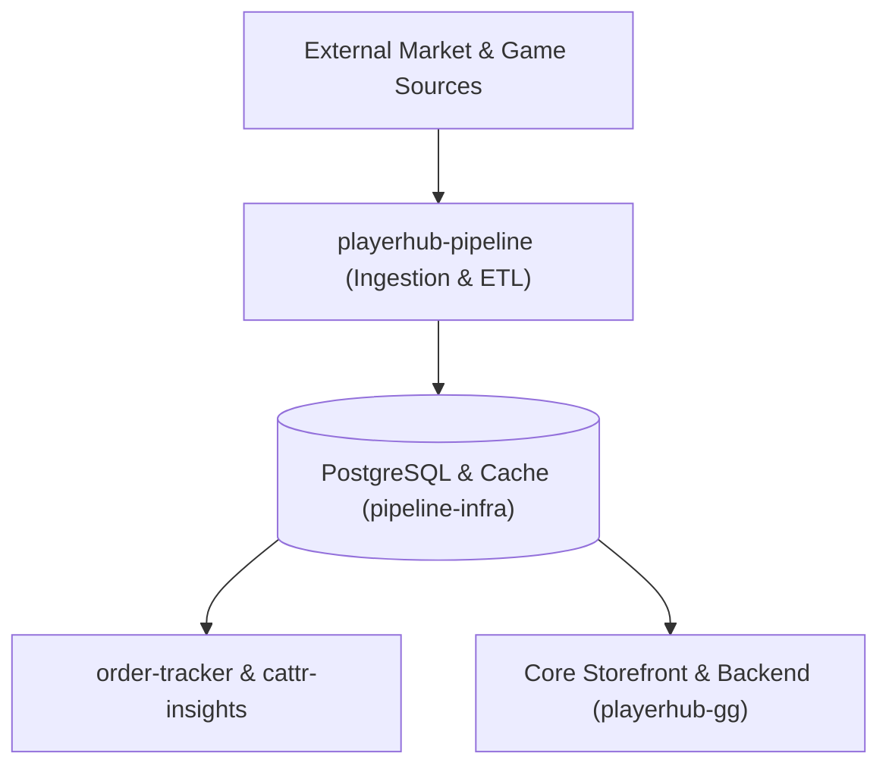

# PlayerHub Pipeline & Data Platform

Welcome to the **PlayerHub Pipeline** organization. This organization hosts the high-throughput data processing engine, market intelligence, catalogue pipelines, and associated infrastructure powering the PlayerHub ecosystem.

---

## 🏗️ Architecture & Component Guide

---

## 📦 Repositories Directory

| Repository | Tech Stack | Role |
| :--- | :--- | :--- |
| **[`playerhub-pipeline`](https://github.com/playerhub-pipeline/playerhub-pipeline)** | Python 3.12, uv, Ruff, Pytest | Core ETL, market data normalization, pricing algorithms, and scraper kernel. |
| **[`pipeline-infra`](https://github.com/playerhub-pipeline/pipeline-infra)** | Docker, PostgreSQL, Envoy, Vault, Ansible | Data platform runtime, observability (Prometheus/Loki), database migrations, and host configuration. |
| **[`playerhub-order-tracker-main`](https://github.com/playerhub-pipeline/playerhub-order-tracker-main)** | Python, Microservice | Real-time buyer order status tracking and seller fulfillment webhooks. |
| **[`cattr-insights`](https://github.com/playerhub-pipeline/cattr-insights)** | Python, Analytics | Pipeline operational insights, worker task tracking, and throughput telemetry. |
| **[`game-map`](https://github.com/playerhub-pipeline/game-map)** | Python, Data Mapping | Global game catalog normalization, canonical naming, and platform resolution. |

---

## 🛡️ Engineering & Automation Standards

1. **Pull Requests:** All changes require a Pull Request following the organization PR template. All CI checks (linting, typechecks, security scans, unit tests) must pass before merging.
2. **Zero Hardcoded Values:** Workflows, scripts, and runtime services must dynamically read configurations from environment variables or GitHub repository variables.
3. **Secret Hygiene:** Never commit secrets or raw tokens. Vault and GitHub Encrypted Secrets manage all credentials. Push protection and secret scanners run on every push.
4. **Dependency Integrity:** Automated Dependabot vulnerability alerts and safe patch auto-merging ensure zero dependency CVEs across the platform.
