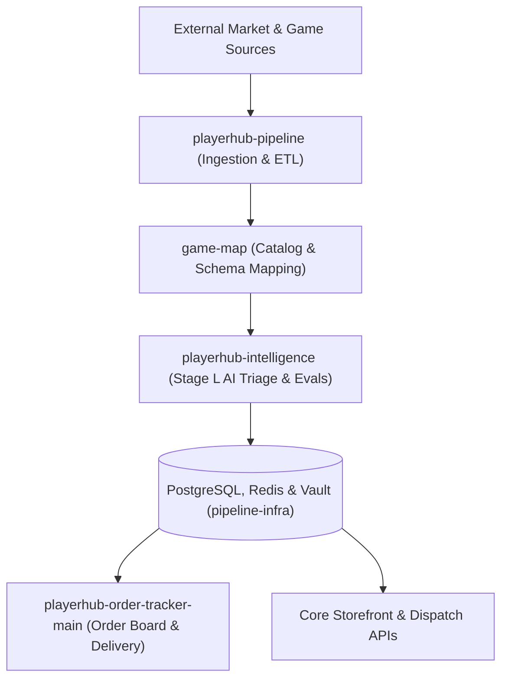

# PlayerHub Pipeline & Data Platform

Welcome to the **PlayerHub Pipeline** organization. This organization hosts the high-throughput data processing engine, market intelligence, catalogue pipelines, order fulfillment microservices, and automated infrastructure powering the PlayerHub ecosystem.

---

## 🏗️ Architecture & Component Guide

---

## 📦 Repositories Directory

| Repository | Tech Stack | Role |
| :--- | :--- | :--- |
| **[`playerhub-pipeline`](https://github.com/playerhub-pipeline/playerhub-pipeline)** | Python 3.12, uv, Ruff, Pytest, MySQL 8.0 | Core ETL, market ingestion, pricing algorithms, remediation loops, and multi-site uploaders. |
| **[`playerhub-intelligence`](https://github.com/playerhub-pipeline/playerhub-intelligence)** | Python 3.12, FastAPI, Pydantic v2, Ruff | Stage L AI triage, prompt version evaluation, Pareto hyperparameter comparator, and confusion matrix analytics. |
| **[`game-map`](https://github.com/playerhub-pipeline/game-map)** | Python 3.12, Pytest, curl_cffi | Global cross-marketplace catalog normalization, category mapping, and canonical game entity resolution. |
| **[`playerhub-order-tracker-main`](https://github.com/playerhub-pipeline/playerhub-order-tracker-main)** | Python 3.14, Django 6.1, React 19, Vite, Redis | Internal real-time order board, delivery automation, buyer support rooms, and employee shift analytics. |
| **[`pipeline-infra`](https://github.com/playerhub-pipeline/pipeline-infra)** | Docker Compose, HashiCorp Vault 1.17, Prometheus, Ansible | Host infrastructure, secret management, backup automation (Rclone offsite crypt), and Prometheus alerting. |
| **[`.github`](https://github.com/playerhub-pipeline/.github)** | Markdown, GitHub Actions | Organization-wide standards, community health files, issue/PR templates, and security policies. |

---

## 🛡️ Engineering & Automation Standards

1. **Pull Requests:** All changes require a Pull Request following the organization PR template. 100% of CI checks (linting, typechecks, security scans, unit tests) must pass green before merging.
2. **Zero Hardcoded Values:** Workflows, scripts, and runtime services must dynamically read configurations from environment variables, Vault secrets, or configuration classes.
3. **Secret Hygiene:** Never commit secrets, raw tokens, or private keys. HashiCorp Vault and GitHub Encrypted Secrets manage all credentials. Push protection and secret scanners enforce clean code on every branch.
4. **Dependency Integrity:** Automated Dependabot vulnerability alerts and safe patch auto-merging ensure zero dependency CVEs across the platform.
5. **Clean Commit History:** Conventional Commits (`feat:`, `fix:`, `refactor:`, `docs:`, `ci:`) with co-authorship for shared engineering contributions.
